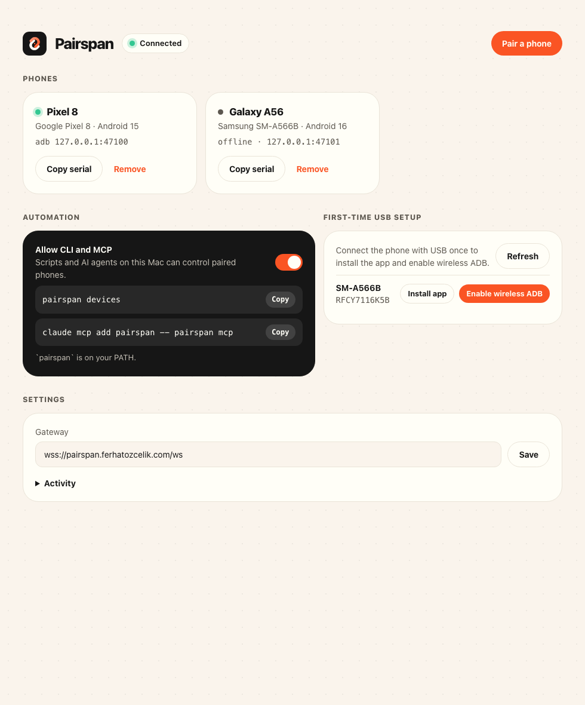
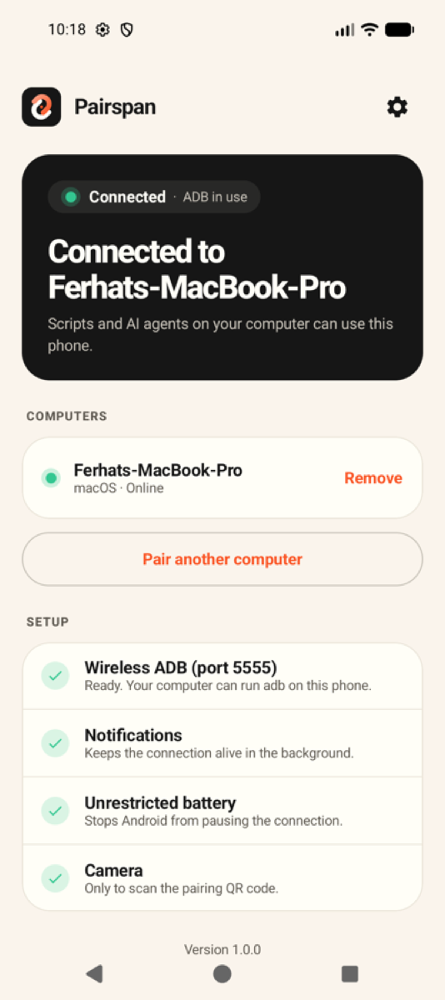
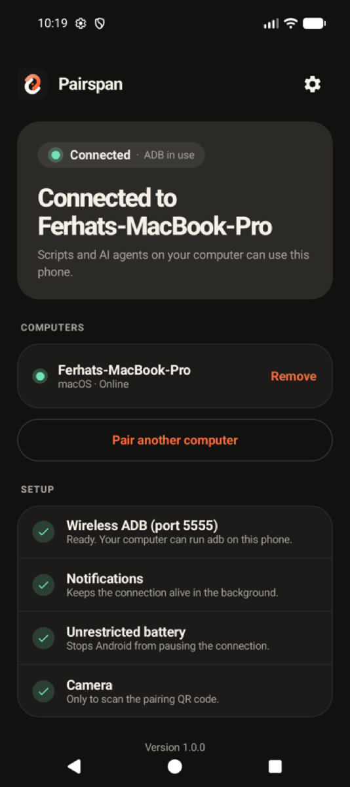

<p align="center">
  <a href="https://ferhatozcelik.github.io/pairspan/"></a>
</p>

<h1 align="center">Pairspan</h1>

<p align="center"><b>Your Android phone, one line away.</b><br>
Plug it in once, then drive the phone from your terminal, scripts or AI agents —<br>
over Wi-Fi or mobile data, end-to-end encrypted.</p>

<p align="center">
  <a href="https://ferhatozcelik.github.io/pairspan/">Website</a> ·
  <a href="https://github.com/ferhatozcelik/pairspan#use-it">How to use</a> ·
  <a href="https://github.com/ferhatozcelik/pairspan/releases/latest">Download</a> ·
  <a href="README.tr.md">Türkçe</a>
</p>

<table align="center">
  <tr>
    <td></td>
    <td></td>
    <td></td>
  </tr>
</table>

## What it does

- **adb from anywhere.** Each paired phone shows up as `127.0.0.1:47100` in `adb devices`, Android Studio and every adb-based tool — the phone can be on another network.
- **`pairspan` CLI.** Tap, type, swipe, find elements, screenshots, apps, logs: `pairspan click "Log in"`.
- **MCP server for AI agents.** `claude mcp add pairspan -- pairspan mcp` gives Claude, Cursor or VS Code a phone to look at and act on. `--read-only` limits it to looking.
- **Direct and end-to-end encrypted.** The phone and the computer connect peer to peer (WebRTC); P-256 handshake and AES-256-GCM on top, so only the two devices hold the keys.
- **No account, no server to run.** Devices find each other through Supabase Realtime; nothing else is involved.

## Install

```bash
curl -fsSL https://ferhatozcelik.github.io/pairspan/install.sh | sh
```

Installs `Pairspan.app` (menu bar) and links the bundled `pairspan` command. Requires macOS 11+ on Apple silicon; the phone needs Android 8+.

## Use it

1. On the phone, turn on **USB debugging** (Settings → About phone → tap *Build number* 7 times, then Developer options → USB debugging).
2. Plug the phone into the Mac and allow it when the phone asks. Pairspan installs (or updates) its Android app, pairs both sides over the cable and turns on wireless ADB. Both apps show each step.
3. Unplug. The phone stays reachable over Wi-Fi or mobile data. After the phone restarts, plug it in once more so wireless ADB comes back.

Each app has one switch: turn Pairspan off on either side and the link stays down until it is turned back on.

```bash
pairspan devices                      # paired phones and their adb serials
pairspan launch com.android.settings
pairspan elements "Network"           # UI elements (text, id, bounds)
pairspan click "Network & internet"   # tap an element by text, id or description
pairspan tap 540 1200 · swipe 540 1600 540 400 · text "hello" · key back
pairspan screenshot shot.png · dump · current · apps · logcat
pairspan shell getprop ro.product.model
pairspan adb -- install -r app.apk    # any adb command
pairspan status · unpair <phone>
claude mcp add pairspan -- pairspan mcp   # MCP for Claude; same command for Cursor / VS Code
```

## How it fits together

```
 pairspan CLI ─┐
 MCP (agents) ─┼─ local socket ─► Pairspan app (Tauri) ══════ WebRTC data channel ══════ Android app ── 127.0.0.1:5555 (adbd)
 scripts      ─┘  (this user)      keys · pairings · adb        end-to-end encrypted
                                          │                                                   │
                                          └──── Supabase Realtime: presence + offer/answer ───┘
                                                (who is online, how to connect; no data)
```

- **Pairing.** Over USB the computer hands the phone a one-time 20-character secret and its id (`adb shell am broadcast` to a receiver only `adb shell` may call). Both meet on a Realtime channel named after the secret's hash, exchange public keys, and the first handshake is bound to the secret.
- **Linking.** Each computer–phone pair has its own Realtime channel named after a hash of both public keys. Presence says who is online; broadcast carries the WebRTC offer and answer. STUN finds a direct path; a few very strict networks block that.
- **Protocol.** The frames inside the data channel are the end-to-end encrypted session of [`docs/protocol.md`](docs/protocol.md).

### Use your own Supabase project

The apps use a public Pairspan project with a publishable key that only reaches public Realtime channels. To use your own, enable Realtime with public channels and set `PAIRSPAN_SUPABASE_URL` / `PAIRSPAN_SUPABASE_KEY` for the desktop app, and the URL in `apps/android/.../link/Realtime.kt` for the Android build. No tables or functions are needed.

## Repository

| Path | What |
|---|---|
| `crates/core` | Rust PC agent: identity, handshake, encrypted sessions, Supabase signalling, WebRTC link, USB setup, ADB tunnel, automation, local JSON-RPC |
| `crates/cli` | `pairspan` command and MCP server (talks only to the app) |
| `apps/desktop` | Tauri app (menu bar + window); bundles the CLI and adb |
| `apps/android` | Kotlin/Compose app; answers the WebRTC link, responder side of the protocol, bridge to the phone's adbd |
| `apps/web` | Website (static export to GitHub Pages) |
| `docs/` | [`protocol.md`](docs/protocol.md), [`design.md`](docs/design.md), shared crypto test vectors |

## Develop

```bash
cargo test -p pairspan-core -p pairspan-cli
cargo test -p pairspan-core --test link -- --ignored   # pairing + tunnel over the real signalling and WebRTC
                                                       # (real_phone_over_usb also needs a phone on USB)
(cd apps/android && ./gradlew :app:testDebugUnitTest :app:assembleDebug)
npm install && npm run build      # website → apps/web/out
npm run desktop                   # Pairspan.app with CLI and adb inside
./install.sh --source             # build and install from this checkout
```

Releases: push a `vX.Y.Z` tag; `.github/workflows/release.yml` builds the macOS app and the signed APK. The website deploys from `main` with `.github/workflows/pages.yml`.

## License

MIT. Third-party notices: [THIRD_PARTY_NOTICES.md](THIRD_PARTY_NOTICES.md).
