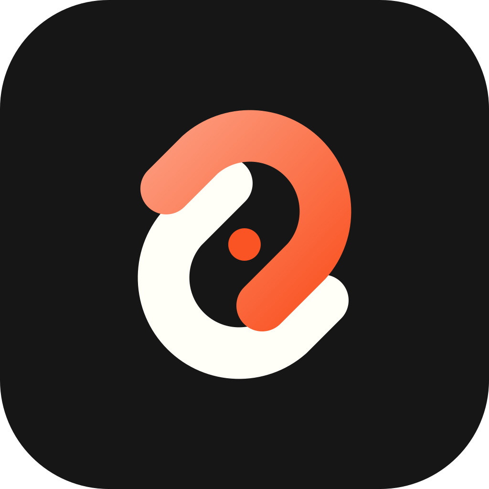
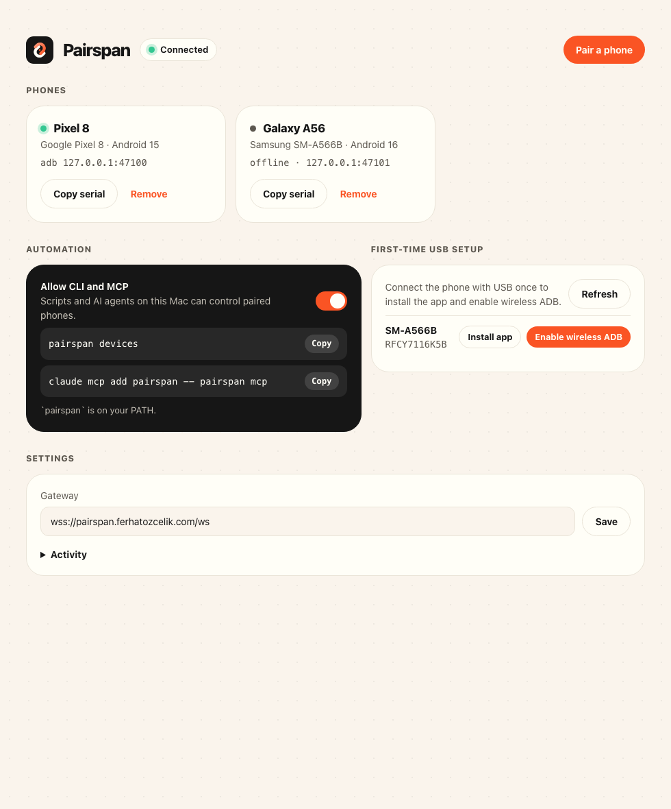
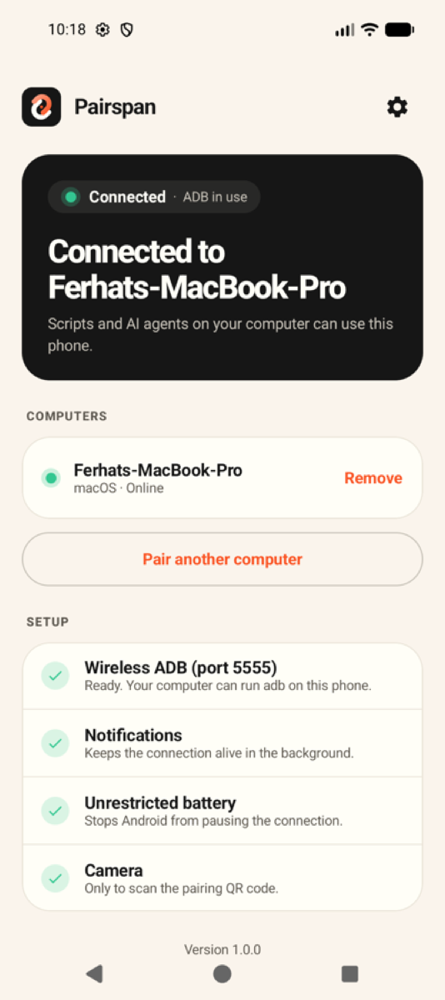
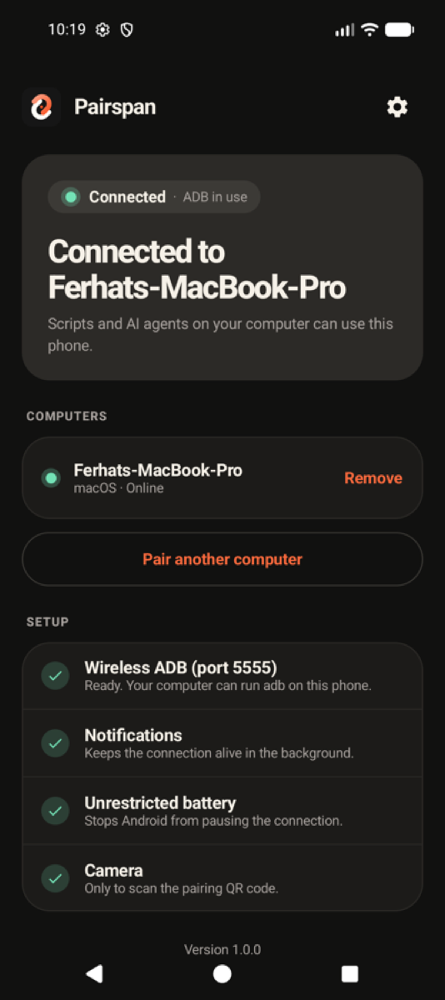

<p align="center">
  <a href="https://pairspan.ferhatozcelik.com"></a>
</p>

<h1 align="center">Pairspan</h1>

<p align="center"><b>Your Android phone, one line away.</b><br>
Pair once with a QR code, then drive the phone from your terminal, scripts or AI agents —<br>
over Wi-Fi or mobile data, end-to-end encrypted.</p>

<p align="center">
  <a href="https://pairspan.ferhatozcelik.com">Website</a> ·
  <a href="https://pairspan.ferhatozcelik.com/docs/">Docs</a> ·
  <a href="https://github.com/ferhatozcelik/pairspan/releases/latest">Download</a> ·
  <a href="README.tr.md">Türkçe</a>
</p>

<table align="center">
  <tr>
    <td></td>
    <td></td>
    <td></td>
  </tr>
</table>

## What it does

- **adb from anywhere.** Each paired phone shows up as `127.0.0.1:47100` in `adb devices`, Android Studio and every adb-based tool — the phone can be on another network.
- **`pairspan` CLI.** Tap, type, swipe, find elements, screenshots, apps, logs: `pairspan click "Log in"`.
- **MCP server for AI agents.** `claude mcp add pairspan -- pairspan mcp` gives Claude, Cursor or VS Code a phone to look at and act on. `--read-only` limits it to looking.
- **End-to-end encrypted.** P-256 handshake and AES-256-GCM between your computer and phone; the gateway only routes ciphertext and never sees the pairing code.
- **Self-hostable.** The gateway and website are one 5.7 MB container with no state.

## Install

```bash
curl -fsSL https://pairspan.ferhatozcelik.com/install.sh | sh
```

Installs `Pairspan.app` (menu bar) and links the bundled `pairspan` command. Then install `pairspan-android-1.0.0.apk` on the phone (or click **Install app** in the desktop app with the phone on USB), click **Pair a phone**, scan the code, and click **Enable wireless ADB** once over USB.

```bash
pairspan devices
pairspan launch com.android.settings
pairspan click "Network & internet"
pairspan screenshot shot.png
claude mcp add pairspan -- pairspan mcp
```

Full guide: [pairspan.ferhatozcelik.com/docs](https://pairspan.ferhatozcelik.com/docs/).

## How it fits together

```
 pairspan CLI ─┐
 MCP (agents) ─┼─ local socket ─► Pairspan app (Tauri) ══╗   wss, end-to-end encrypted
 scripts      ─┘  (this user)      keys · pairings · adb  ║
                                                          ▼
                                   gateway (Rust, one container) — routes ciphertext
                                                          ▲
                                   Android app ═══════════╝ ── 127.0.0.1:5555 (adbd)
```

## Repository

| Path | What |
|---|---|
| `crates/gateway` | Rust relay: authentication, pairing rooms, binary routing, `/health`, `/metrics`, serves the website |
| `crates/core` | Rust PC agent: identity, handshake, encrypted sessions, ADB tunnel, automation, local JSON-RPC |
| `crates/cli` | `pairspan` command and MCP server (talks only to the app) |
| `apps/desktop` | Tauri app (menu bar + window); bundles the CLI and adb |
| `apps/android` | Kotlin/Compose app; responder side of the protocol, bridge to the phone's adbd |
| `apps/web` | Next.js website and docs (static export) |
| `docs/` | [`protocol.md`](docs/protocol.md), [`design.md`](docs/design.md), shared crypto test vectors |

## Develop

```bash
cargo test -p pairspan-gateway -p pairspan-core -p pairspan-cli   # includes an end-to-end pairing + tunnel test
(cd apps/android && ./gradlew :app:testDebugUnitTest :app:assembleDebug)
npm install && npm run build      # website → apps/web/out
npm run desktop                   # Pairspan.app with CLI and adb inside
./install.sh --source             # build and install from this checkout
docker build -t pairspan:latest . # gateway + website image
```

Run a local gateway: `PORT=8080 cargo run -p pairspan-gateway`, then set the gateway to `ws://<your-ip>:8080/ws` in the desktop and Android apps.

## License

MIT. Vendored third-party code is listed in [THIRD_PARTY_NOTICES.md](THIRD_PARTY_NOTICES.md).
