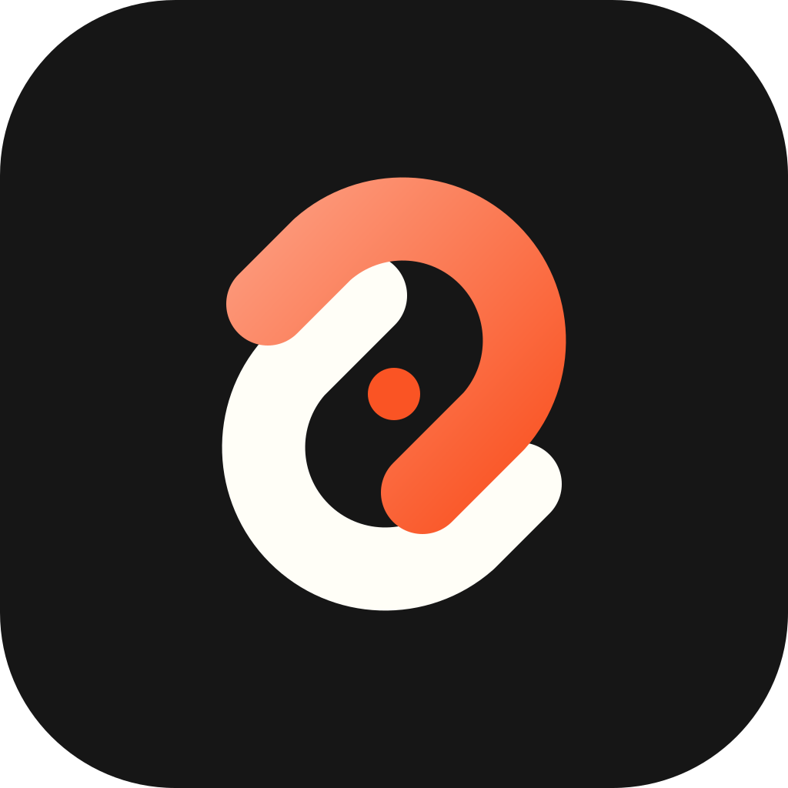
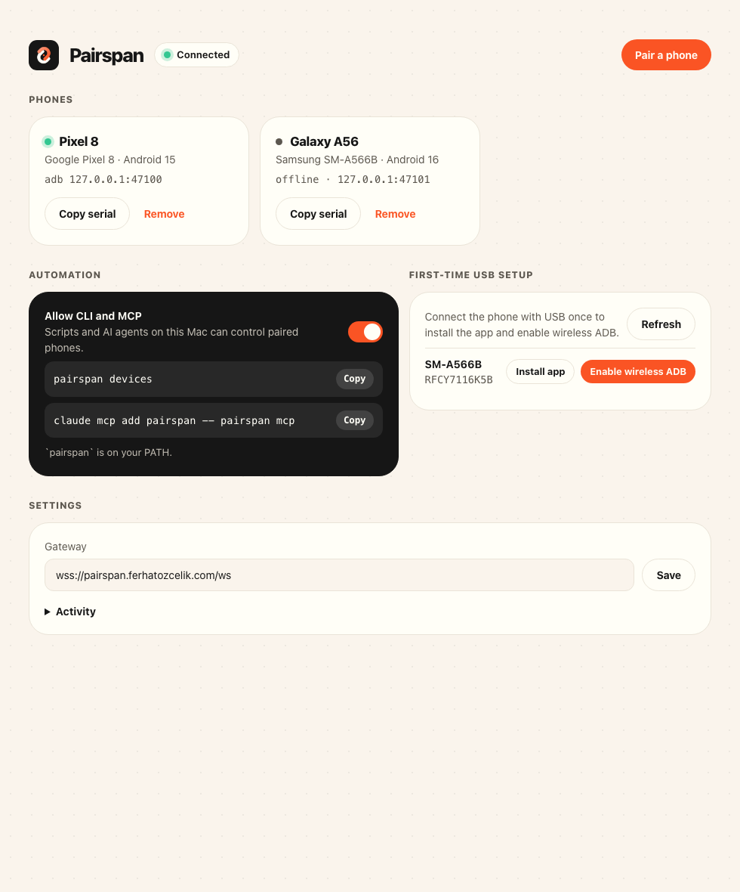
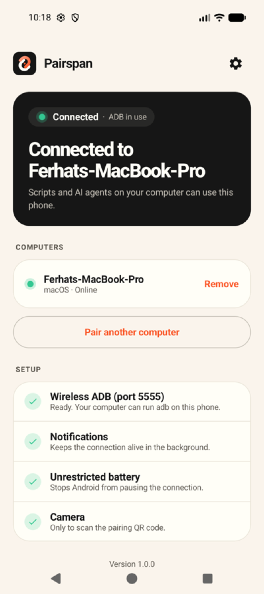
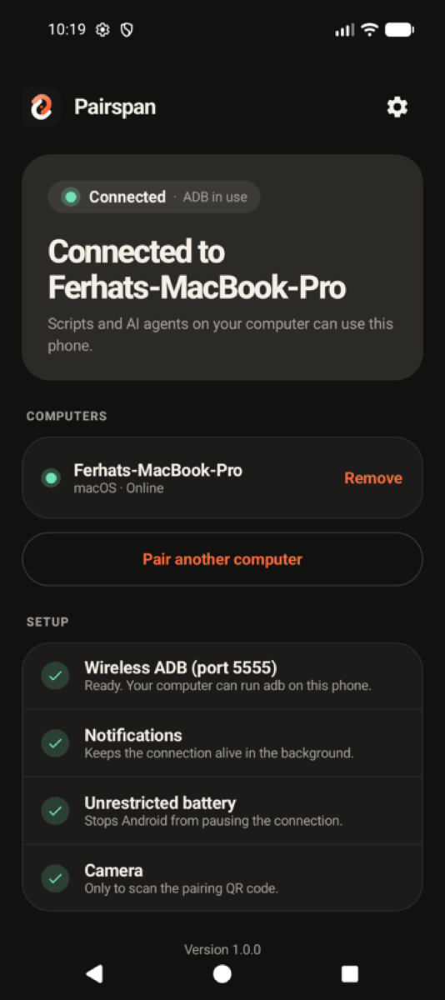

<p align="center">
  <a href="https://ferhatozcelik.github.io/pairspan/tr/"></a>
</p>

<h1 align="center">Pairspan</h1>

<p align="center"><b>Android telefonun, bir satır uzağında.</b><br>
Bir kez USB ile tak; sonra telefonu terminalden, scriptlerden ya da yapay zekâ ajanlarından yönet —<br>
Wi-Fi veya mobil veri üzerinden, uçtan uca şifreli.</p>

<p align="center">
  <a href="https://ferhatozcelik.github.io/pairspan/tr/">Web sitesi</a> ·
  <a href="https://github.com/ferhatozcelik/pairspan/blob/main/README.tr.md#kullanım">Nasıl kullanılır</a> ·
  <a href="https://github.com/ferhatozcelik/pairspan/releases/latest">İndir</a> ·
  <a href="README.md">English</a>
</p>

<table align="center">
  <tr>
    <td></td>
    <td></td>
    <td></td>
  </tr>
</table>

## Ne yapar

- **Her yerden adb.** Eşleşen her telefon `adb devices`, Android Studio ve tüm adb araçlarında `127.0.0.1:47100` olarak görünür; telefon başka bir ağda olabilir.
- **`pairspan` CLI.** Dokun, yaz, kaydır, öğe bul, ekran görüntüsü al, uygulama ve log: `pairspan click "Giriş yap"`.
- **Yapay zekâ ajanları için MCP.** `claude mcp add pairspan -- pairspan mcp` ile Claude, Cursor veya VS Code telefonu görüp kullanabilir. `--read-only` yalnızca bakmaya izin verir.
- **Doğrudan ve uçtan uca şifreli.** Telefon ile bilgisayar eşler arası (WebRTC) bağlanır; üstünde P-256 el sıkışması ve AES-256-GCM, anahtarlar yalnızca iki cihazda.
- **Hesap yok, çalıştırılacak sunucu yok.** Cihazlar birbirini Supabase Realtime üzerinden bulur; başka hiçbir şey araya girmez.

## Kurulum

```bash
curl -fsSL https://ferhatozcelik.github.io/pairspan/install.sh | sh
```

`Pairspan.app`'i (menü çubuğu) kurar ve içindeki `pairspan` komutunu PATH'e bağlar. Apple silicon'lı macOS 11+ gerekir; telefonda Android 8+.

## Kullanım

1. Telefonda **USB hata ayıklama**yı aç (Ayarlar → Telefon hakkında → *Derleme numarası*na 7 kez dokun, sonra Geliştirici seçenekleri → USB hata ayıklama).
2. Telefonu Mac'e tak ve telefon sorduğunda izin ver. Pairspan Android uygulamasını kurar (ya da günceller), iki tarafı kablo üzerinden eşleştirir ve kablosuz ADB'yi açar. İki uygulama da her adımı gösterir.
3. Kabloyu çıkar. Telefon Wi-Fi veya mobil veri üzerinden erişilebilir kalır. Telefon yeniden başlarsa kablosuz ADB için bir kez daha tak.

İki uygulamada da tek bir anahtar var: Pairspan'i bir tarafta kapat, tekrar açılana kadar bağlantı kapalı kalır.

Komutlar ve mimari için [İngilizce README](README.md#use-it).

## Lisans

MIT. Üçüncü taraf bildirimleri: [THIRD_PARTY_NOTICES.md](THIRD_PARTY_NOTICES.md).
