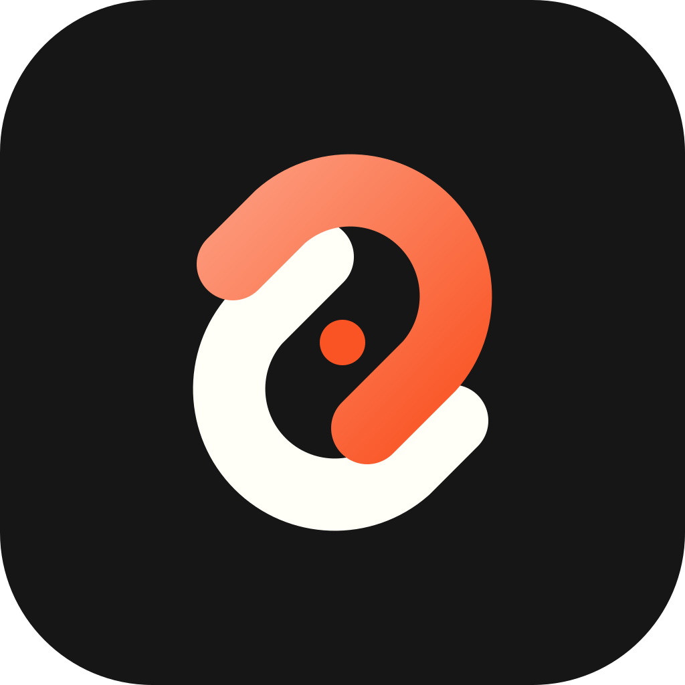
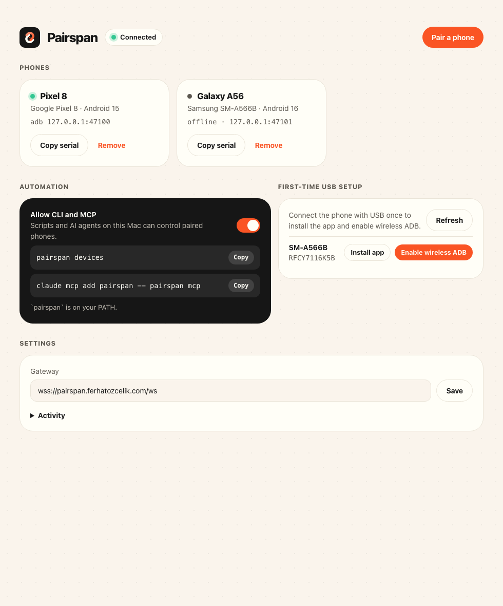
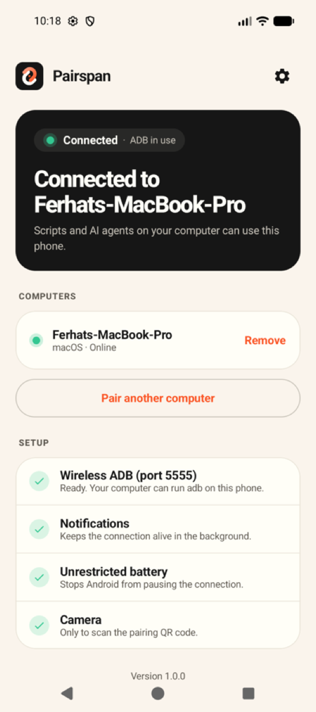
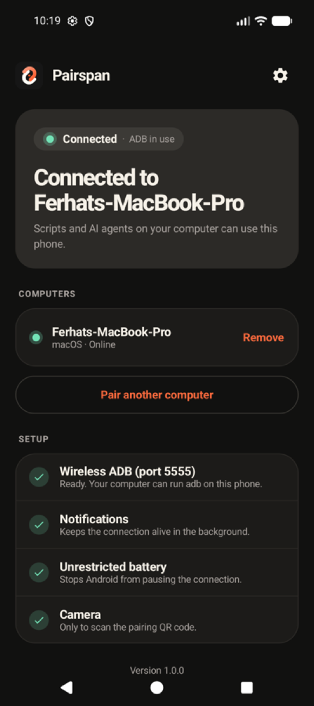

<p align="center">
  <a href="https://pairspan.ferhatozcelik.com/tr/"></a>
</p>

<h1 align="center">Pairspan</h1>

<p align="center"><b>Android telefonun, bir satır uzağında.</b><br>
Bir kez QR kodla eşleştir; sonra telefonu terminalden, scriptlerden ya da yapay zekâ ajanlarından yönet —<br>
Wi-Fi veya mobil veri üzerinden, uçtan uca şifreli.</p>

<p align="center">
  <a href="https://pairspan.ferhatozcelik.com/tr/">Web sitesi</a> ·
  <a href="https://pairspan.ferhatozcelik.com/docs/">Dokümanlar</a> ·
  <a href="https://github.com/ferhatozcelik/pairspan/releases/latest">İndir</a> ·
  <a href="README.md">English</a>
</p>

<table align="center">
  <tr>
    <td></td>
    <td></td>
    <td></td>
  </tr>
</table>

## Ne yapar

- **Her yerden adb.** Eşleşen her telefon `adb devices`, Android Studio ve tüm adb araçlarında `127.0.0.1:47100` olarak görünür; telefon başka bir ağda olabilir.
- **`pairspan` CLI.** Dokun, yaz, kaydır, öğe bul, ekran görüntüsü al, uygulama ve log: `pairspan click "Giriş yap"`.
- **Yapay zekâ ajanları için MCP.** `claude mcp add pairspan -- pairspan mcp` ile Claude, Cursor veya VS Code telefonu görüp kullanabilir. `--read-only` yalnızca bakmaya izin verir.
- **Uçtan uca şifreli.** Bilgisayar ile telefon arasında P-256 el sıkışması ve AES-256-GCM; gateway yalnızca şifreli veriyi yönlendirir, eşleştirme kodunu hiç görmez.
- **Kendi sunucunda çalıştırılabilir.** Gateway ve web sitesi durumsuz, 5,7 MB'lık tek bir container.

## Kurulum

```bash
curl -fsSL https://pairspan.ferhatozcelik.com/install.sh | sh
```

`Pairspan.app`'i (menü çubuğu) kurar ve içindeki `pairspan` komutunu PATH'e bağlar. Ardından telefona `pairspan-android-1.0.0.apk`'yı kur (ya da telefon USB'deyken masaüstü uygulamasında **Install app**'e tıkla), **Pair a phone**'a tıkla, kodu tara ve USB üzerinden bir kez **Enable wireless ADB**'ye tıkla.

```bash
pairspan devices
pairspan launch com.android.settings
pairspan click "Ağ ve internet"
pairspan screenshot ekran.png
claude mcp add pairspan -- pairspan mcp
```

Ayrıntılı rehber: [pairspan.ferhatozcelik.com/docs](https://pairspan.ferhatozcelik.com/docs/).

## Repo yapısı

| Klasör | İçerik |
|---|---|
| `crates/gateway` | Rust relay: kimlik doğrulama, eşleştirme odaları, binary yönlendirme, `/health`, `/metrics`, web sitesini sunar |
| `crates/core` | Rust PC ajanı: kimlik, el sıkışma, şifreli oturumlar, ADB tüneli, otomasyon, yerel JSON-RPC |
| `crates/cli` | `pairspan` komutu ve MCP sunucusu (yalnızca uygulamayla konuşur) |
| `apps/desktop` | Tauri uygulaması (menü çubuğu + pencere); CLI ve adb içinde gelir |
| `apps/android` | Kotlin/Compose uygulaması; telefonun adbd'sine köprü |
| `apps/web` | Next.js web sitesi ve dokümanlar (statik export) |
| `docs/` | [`protocol.md`](docs/protocol.md), [`design.md`](docs/design.md), ortak şifreleme test vektörleri |

## Geliştirme

```bash
cargo test -p pairspan-gateway -p pairspan-core -p pairspan-cli
(cd apps/android && ./gradlew :app:testDebugUnitTest :app:assembleDebug)
npm install && npm run build      # web sitesi → apps/web/out
npm run desktop                   # CLI ve adb gömülü Pairspan.app
./install.sh --source             # bu klasörden derleyip kur
docker build -t pairspan:latest . # gateway + web sitesi imajı
```

## Lisans

MIT. Projeye dahil edilen üçüncü taraf kodlar [THIRD_PARTY_NOTICES.md](THIRD_PARTY_NOTICES.md) dosyasında.
